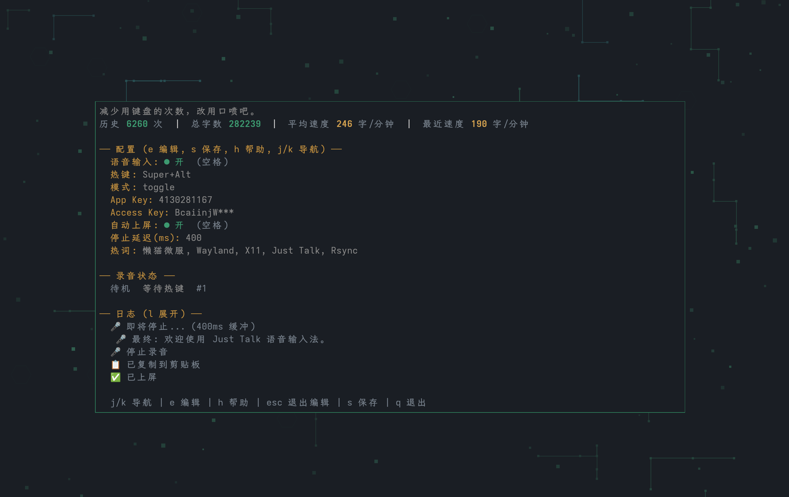

# Just Talk

[English](README.en.md)

减少用键盘的次数，改用口喷吧。

Just Talk 是一个面向桌面环境的语音输入工具。它通过全局快捷键录音，把语音识别结果复制到剪贴板，或直接上屏到当前输入框，适合写代码、聊天、记笔记和处理长文本输入。

## 截图



## 功能

- 全局快捷键录音，支持 `toggle` 和 `hold` 两种模式。
- 语音热键限定为适合作为全局快捷键的按键：支持纯修饰键、功能键、Tab、CapsLock、方向键和导航键等；不支持字母、数字、标点、空格等普通字符键。
- 流式 ASR：默认微软 Azure 语音服务，可切换为豆包大模型（火山引擎）。
- 自动复制到剪贴板，支持自动上屏。
- Wayland / X11 / macOS 顶层录音状态胶囊提示。
- TUI 配置界面，支持热键、模式、自动上屏、停止延迟、热词等配置。
- 热词增强识别，适合项目名、人名、英文术语和专有名词。
- 录音历史统计，包括历史次数、总字数、平均速度和最近速度。
- 区域截图：默认 `Ctrl+Command+A` 鼠标框选，截图直接进剪贴板。
- 保持在线（macOS）：指定时段内防止系统进入空闲，Slack 等应用不会显示离开。

## 平台状态

当前开发重点是 Linux 和 macOS 桌面：

| 平台 | 状态 | 说明 |
| --- | --- | --- |
| Linux Wayland | 已支持 | 已支持 Sway / wlroots 场景；快捷键基于 evdev，需要 input 权限 |
| Linux X11 | 已支持 | 使用 X11 原生全局热键 |
| macOS | 已支持 | 全局快捷键基于 CGEventTap，录音使用 CoreAudio，剪贴板使用 NSPasteboard，胶囊显示使用 AppKit NSPanel |
| Windows | 未实现 | 暂不支持 |

## 构建

Just Talk 依赖平台原生能力，构建时需要启用 cgo。

Linux 构建依赖：

```bash
# Arch Linux
sudo pacman -S --needed go gcc libx11 libxtst libxext wayland

# Debian / Ubuntu
sudo apt install golang-go build-essential libx11-dev libxtst-dev libxext-dev libxinerama-dev libwayland-dev
```

macOS 构建依赖：

```bash
# 需要 Apple Command Line Tools 提供 clang 和 macOS SDK；不需要安装完整 Xcode。
xcode-select --install
```

构建当前平台二进制：

```bash
CGO_ENABLED=1 go build -o build/just-talk ./cmd/just-talk
```

安装到 `~/.local/bin/just-talk`：

```bash
build/just-talk --install
# 或
make install
```

macOS 需要在本机 macOS 上构建；项目不提供非 cgo 版本。

## 使用

默认启动 TUI：

```bash
just-talk
```

后台模式：

```bash
just-talk --no-tui
```

指定后端：

```bash
just-talk --backend wayland
just-talk --backend x11
```

## 配置

默认配置路径：

```text
~/.config/just-talk/config.toml
```

推荐热键配置：

```toml
[voice]
mode = "toggle"
push_to_talk = "Alt+Super"
```

`Alt+Super` 配合 `toggle` 模式是推荐用法。按一次开始录音，再按一次停止录音，避免按住模式下和桌面环境或输入框发生按键冲突。

语音热键只支持适合作为全局快捷键的按键：

- 支持：纯修饰键组合，如 `Alt+Super`、`Ctrl+Alt+Shift`。
- 支持：功能键 `F1` 到 `F24`，如 `F9`、`Alt+F8`。
- 支持：非文本控制键和导航键，如 `Tab`、`Enter`、`Escape`、`Backspace`、`CapsLock`、`Up`、`Down`、`Left`、`Right`、`Home`、`End`、`PageUp`、`PageDown`、`Insert`、`Delete`。
- 不支持：字母、数字、标点、空格、数字小键盘数字和符号等会输入文本的按键，如 `Alt+G`、`G`、`Alt+1`、`Alt+Space`。

ASR 配置（默认 Azure，在 Azure 门户创建「语音服务」资源，取「密钥和终结点」页的密钥与区域）：

```toml
[voice]
provider = "azure"
azure_key = "<密钥>"
azure_region = "eastasia"
```

使用火山引擎时设 `provider = "volcengine"`，并填写 `app_key`、`access_key`。

热词示例：

```toml
[voice]
hotwords = ["Wayland", "Sway", "wl-copy", "wtype", "just-talk-go"]
```

macOS 热键写法：

```toml
[voice]
# Option 等价于 Alt，Command/Cmd 等价于 Super
push_to_talk = "Option+Command"
```

区域截图（框选后图片直接进剪贴板，Esc 取消）：

```toml
[screenshot]
enabled = true
hotkey = "Ctrl+Cmd+A"
```

- macOS 通过模拟系统快捷键 `⌃⇧⌘4`（拷贝所选区域的图片）调起系统截图，不需要给终端授予「屏幕录制」权限。按下热键时先用 `⌃⇧⌘3` 抓下主屏并以静止画面盖住屏幕，框选的是这张冻结画面，因此会听到两次快门声；副屏不冻结。若在「系统设置 → 键盘 → 键盘快捷键 → 截屏」中改掉或关闭了这两个快捷键，冻结或截图会失效。框选前会在光标上叠加红色十字，按下鼠标后消失；Esc 或 60 秒未完成视为取消，剪贴板恢复原内容。默认热键与 macOS 微信截图键相同，两边会同时触发，可改其中一方。框选完成后原地进入标注：选区外压暗、只有选区亮着，鼠标进到选区里会变成小十字，直接在那块位置拖拽画红色矩形框（线宽 5 像素，可画多个），`⌘Z` 或 Backspace 撤销，`Enter` 或双击复制，`Esc` 或右键取消；一个框都不画直接 `Enter` 就是原图。标注期间选区外的点击不会落到后面的应用上。
- Linux X11 需要 `maim`；Wayland 需要 `slurp` 和 `grim`，仅支持 Sway / Hyprland 等 wlroots 合成器，GNOME / KDE Wayland 暂不支持。

保持在线（仅 macOS，默认关闭）：

```toml
[presence]
enabled = true
start = "09:00"
end = "20:00"   # 早于 start 表示跨午夜
```

- 时段内键鼠空闲超过 4 分钟时发送一次原地鼠标事件（光标不动），并阻止显示器休眠；时段外不做任何事。
- 依赖终端已有的「辅助功能」权限；合盖或锁屏后无效。

## 更新日志

见 [CHANGELOG.md](CHANGELOG.md)。

## 维护与贡献

Just Talk 由 `whoamihappyhacking` 维护。

本项目不接受 Pull Request。欢迎通过 Issue 反馈 bug、使用体验和功能建议。

## 许可证

Just Talk 使用 GNU General Public License v3.0 开源。
